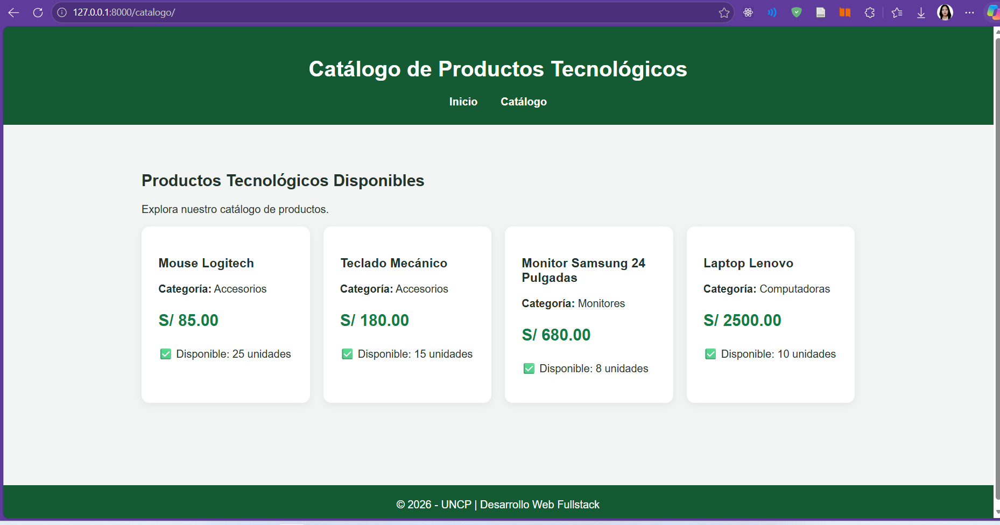
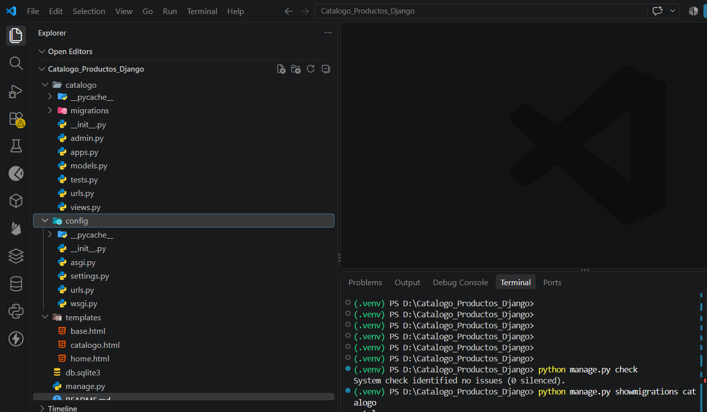
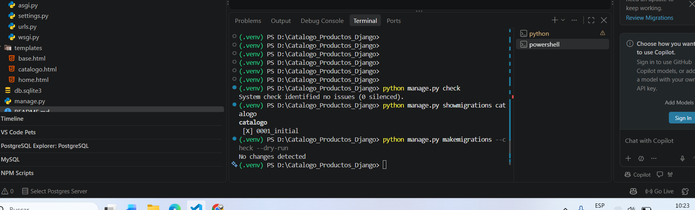

# Catálogo de Productos Tecnológicos

## 1. Descripción del proyecto

Aplicación web desarrollada con Python y Django
que permite visualizar un catálogo de productos
tecnológicos disponibles.

Universidad Nacional del Centro del Perú (UNCP)
Asignatura: Desarrollo de Aplicaciones Web
Semana 11 - Práctica grupal

## 2. Tecnologías utilizadas

- Python
- Django 5.2
- SQLite
- HTML5
- CSS3

## 3. Arquitectura MTV

El proyecto utiliza el patrón Model-Template-View.

Flujo principal:

Navegador (Request)
        |
        v
URLs (Enrutamiento)
        |
        v
View (Lógica)
        |
        v
Model (ORM / SQLite)
        |
        v
Template (HTML)
        |
        v
Navegador (Response)

Componentes:

- Model: catalogo/models.py
- Template: templates/
- View: catalogo/views.py

## 4. Estructura del proyecto

Catalogo_Productos_Django/
|
|-- config/
|-- catalogo/
|-- templates/
|   |-- base.html
|   |-- home.html
|   |-- catalogo.html
|-- capturas/
|-- manage.py
|-- README.md

## 5. Vistas implementadas

FBV:
Página de bienvenida mediante la función home().

CBV:
Lista de productos mediante ProductoListView.

## 6. Consultas ORM (QuerySets)

Consulta 1:

Producto.objects.all()

Obtiene todos los productos registrados.

Consulta 2:

Producto.objects.filter(
    stock__gt=0
).order_by("precio")

Obtiene únicamente productos con stock disponible
y los ordena de menor a mayor precio.

## 7. Lazy Evaluation

Los QuerySets de Django son perezosos.

Esto significa que la consulta SQL generalmente
no se ejecuta al crear el QuerySet, sino al evaluar
sus resultados, por ejemplo, al recorrerlos.

## 8. Instalación y ejecución

Crear un entorno virtual:

    python -m venv .venv

Activarlo en PowerShell:

    .\.venv\Scripts\Activate.ps1

Instalar Django:

    python -m pip install "Django>=5.2,<5.3"

Aplicar migraciones:

    python manage.py migrate

Ejecutar el servidor:

    python manage.py runserver

## 9. Rutas

Inicio:
http://127.0.0.1:8000/

Catálogo:
http://127.0.0.1:8000/catalogo/

## 10. Validación técnica

Comando:

    python manage.py check

Resultado obtenido:

    System check identified no issues (0 silenced).

## 11. Evidencias

### Captura 01: Catálogo funcionando

### Captura 02: Estructura del proyecto

### Captura 03: Validación técnica

